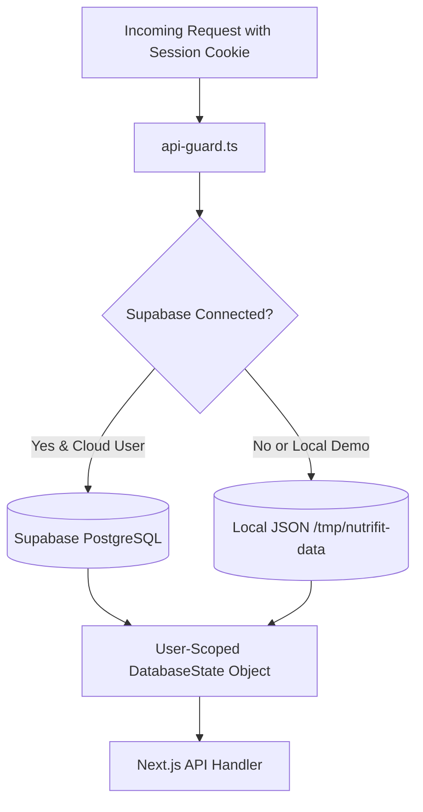
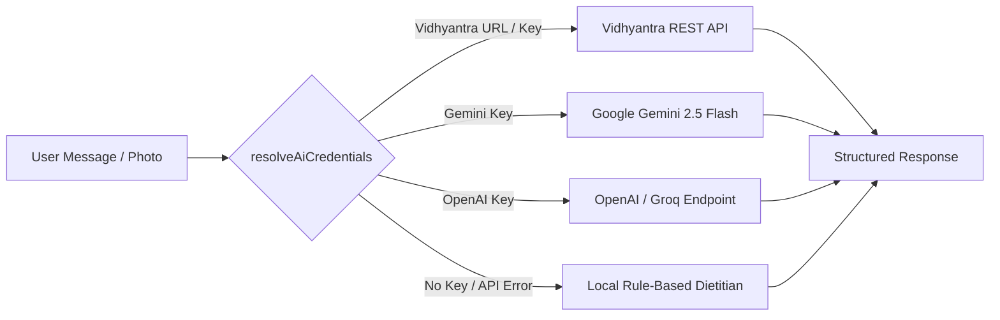

# NutriFit AI — Complete Developer & Architecture Handoff

> **Target Audience:** Any software engineer, designer, or product manager inheriting or working on this repository without prior knowledge of the project. This document explains the complete architecture, every route, component, file, security rule, and database detail.

---

## 📑 Table of Contents
1. [Executive Summary & Architecture](#1-executive-summary--architecture)
2. [PWA Specifications & Mobile Experience](#2-pwa-specifications--mobile-experience)
3. [Page-to-Component Mapping](#3-page-to-component-mapping)
4. [Complete File & Directory Map](#4-complete-file--directory-map)
5. [⚠️ Critical "DO NOT TOUCH" & Stability Rules](#5-critical-do-not-touch--stability-rules)
6. [Environment Variables Reference](#6-environment-variables-reference)
7. [Database Architecture: Supabase + Local Hybrid](#7-database-architecture-supabase--local-hybrid)
8. [AI Engine & Multi-Provider Architecture](#8-ai-engine--multi-provider-architecture)
9. [Future Roadmap & Unfinished Features](#9-future-roadmap--unfinished-features)
10. [Developer Workflows & Cheat-Sheet](#10-developer-workflows--cheat-sheet)

---

## 1. Executive Summary & Architecture

**NutriFit AI** is a Progressive Web Application (PWA) built specifically for pure-vegetarian Indian fitness and nutrition coaching. It combines:
- **Daily Food & Water Diary** with Indian vegetarian database and custom recipe support.
- **AI Camera Meal Scanner** powered by Gemini Vision / Vidhyantra.
- **AI Dietitian Coach** providing context-aware answers using live diary numbers.
- **Body Composition & Scans** tracking weight, body fat %, muscle mass, and EVOLT 360 scan uploads.
- **Customizable Workout Splits** (4-5 Day Push/Pull/Legs and Upper/Lower).
- **Automated Pure-Veg Grocery Planner**.

### Core Tech Stack
| Layer | Technology | Purpose |
| :--- | :--- | :--- |
| **Framework** | Next.js 16 (App Router) | Server-rendered pages, API routes, streaming |
| **Runtime** | React 19 (Server + Client Components) | Modern reactive UI |
| **Language** | TypeScript (Strict mode) | Type safety across entire data pipeline |
| **Styling** | Tailwind CSS v3.4 | Custom design system (Warm Linen & Terracotta) |
| **Typography** | Epilogue (`font-display`) + Manrope (`font-sans`) | Warm, editorial Indian aesthetic |
| **Cloud DB** | Supabase (PostgreSQL + RLS) | Cloud persistence, multi-user isolation |
| **Local Fallback** | JSON Flat-File (`/tmp/nutrifit-data/` on Vercel) | Zero-friction demo and offline persistence |
| **AI Providers** | Google Gemini, Vidhyantra (Custom), OpenAI, Groq | Vision analysis and dietitian chat |

---

## 2. PWA Specifications & Mobile Experience

NutriFit AI is architected mobile-first as an installable standalone application.

### A. Web App Manifest (`public/manifest.json`)
- **Display Mode:** `standalone` (removes browser URL bar and navigation buttons).
- **Orientation:** `portrait-primary` (locks orientation on mobile).
- **Theme Color:** `#B45309` (warm terracotta header on Android status bar).
- **Background Color:** `#F6F4EE` (warm linen background prevents white flash on launch).
- **Icons:** 192x192, 512x512 maskable icons, and 180x180 Apple touch icon.
- **Quick Shortcuts:** Instant access from home screen long-press to:
  1. *Scan Meal* (`/scanner`)
  2. *Food Diary* (`/diary`)
  3. *AI Dietitian* (`/coach`)

### B. Service Worker (`public/sw.js`)
The service worker uses a **hybrid caching strategy** designed specifically for continuous Vercel deployments:
1. **HTML Navigations (Network-First):** Always fetches fresh HTML from Vercel so user code updates deploy immediately without users being trapped on an old cache. Falls back to offline cache if offline.
2. **Static Assets (Stale-While-Revalidate):** Scripts, icons, fonts, and images load instantly from cache while fetching updates in the background.
3. **API Bypassing:** All requests to `/api/*` bypass the service worker entirely to prevent caching dynamic database queries.

### C. Safe Areas & Mobile Viewport (`src/app/layout.tsx`)
- Viewport is configured with `viewportFit: 'cover'`, `userScalable: false`, and `maximumScale: 1`.
- The floating bottom navigation bar in `src/components/AppShell.tsx` uses:
  ```css
  padding-bottom: env(safe-area-inset-bottom, 1rem);
  ```
- All scrollable pages include bottom padding (`pb-28`) so content is never obscured by the floating navigation pill or Android/iOS gesture home indicators.

### D. In-App Install Prompt (`src/components/PwaInstallPrompt.tsx`)
- Listens for the browser's `beforeinstallprompt` event on Chromium (Android, Chrome, Edge).
- Automatically detects iOS Safari and surfaces an elegant modal showing the user how to tap **Share → Add to Home Screen**.
- Automatically dismisses once installed or if previously closed.

---

## 3. Page-to-Component Mapping

The following table details which user-facing screen corresponds to which Next.js route and which components build it:

| Route | Page File | Main Features & Purpose | Key Components Used |
| :--- | :--- | :--- | :--- |
| `/` | `src/app/page.tsx` | Today Dashboard: Calorie gauge, remaining macros, meal slots, quick log buttons, BMI alert | `CalorieArcGauge`, `FoodLogModal`, `BmiAdvisorCard`, `Dropdown` |
| `/diary` | `src/app/diary/page.tsx` | Daily Food Diary: Breakfast, Lunch, Snacks, Dinner macro breakdown, delete logs, quick copy | `FoodLogModal`, `Card`, `Badge`, `Button` |
| `/scanner` | `src/app/scanner/page.tsx` | AI Meal Scanner: Live camera stream, photo capture, base64 AI vision, portion confirmation | `Button`, `Card`, `Input`, `CalmLoader` |
| `/explore` | `src/app/explore/page.tsx` | Indian Food Library: Pure-veg search, categorized food photo cards, click-to-log popup | `FoodLogModal`, `AddCustomFoodModal`, `Chip` |
| `/coach` | `src/app/coach/page.tsx` | AI Indian Dietitian: Multi-turn chat, quick prompt suggestions, live error feedback | `Card`, `Input`, `Send` |
| `/workouts` | `src/app/workouts/page.tsx` | Workout Routine: 4-5 Day customizable routine, exercise cards, sets/reps logger, rest days | `Card`, `Button`, `Badge`, `Tabs` |
| `/progress` | `src/app/progress/page.tsx` | Transformation & Body: Weight trend graph, EVOLT 360 PDF/photo scan upload, waist tracker | `Card`, `Button`, `Input` |
| `/planner` | `src/app/planner/page.tsx` | Meal Planner: Daily, 7-day, and 30-day pure-vegetarian balanced meal plan generator | `Card`, `Button`, `Badge` |
| `/grocery` | `src/app/grocery/page.tsx` | Grocery Planner: Generates categorized pure-veg shopping list based on meal plans | `Card`, `Button`, `Checkbox` |
| `/analytics` | `src/app/analytics/page.tsx` | Macro Trends: 7-day/30-day calorie, protein consistency charts, deficit adherence | `Card`, `Progress` |
| `/habits` | `src/app/habits/page.tsx` | Daily Habits: Water intake counter, step count tracker, sleep logging, consistency score | `Card`, `Progress`, `Button` |
| `/profile` | `src/app/profile/page.tsx` | User Profile: Edit height, weight, body fat %, fitness goal, dietary preferences | `Card`, `Input`, `Button` |
| `/settings` | `src/app/settings/page.tsx` | Settings & Privacy: Connect AI API, Supabase status, password change, backup & restore | `Card`, `Input`, `Button`, `Chip`, `Badge` |
| `/onboarding`| `src/app/onboarding/page.tsx`| First-Time Setup: Step-by-step questionnaire calculating BMI, BMR, TEE, and macro targets | `Card`, `Input`, `Button`, `Progress` |
| `/recipes/[id]`| `src/app/recipes/[id]/page.tsx` | Recipe Detail: High-protein pure-veg recipe view with ingredients, steps, and nutrition | `Card`, `Badge`, `Button` |

---

## 4. Complete File & Directory Map

```text
fit/
├── public/                       # Static public assets & PWA configuration
│   ├── manifest.json             # PWA Web App Manifest (standalone, theme, icons)
│   ├── sw.js                     # PWA Service Worker (Network-First HTML cache)
│   ├── icon-192.png              # Android/Chromium app icon (192px)
│   ├── icon-512.png              # High-res PWA splash icon (512px)
│   └── apple-touch-icon.png      # iOS Safari home screen icon (180px)
│
├── src/
│   ├── app/                      # Next.js App Router (Routes & Endpoints)
│   │   ├── layout.tsx            # Global Root Layout (Fonts, PWA SW registration, ToastProvider)
│   │   ├── page.tsx              # Today Dashboard (Calorie Arc Gauge, Day Logs)
│   │   ├── globals.css           # Tailwind base, warm palette variables, animations
│   │   │
│   │   ├── api/                  # Backend REST API Endpoints
│   │   │   ├── auth/route.ts     # Login, Signup (Client-side Supabase + Local), Session GET
│   │   │   ├── state/route.ts    # Aggregated user state (dashboard, diary, targets, profile)
│   │   │   ├── ai/
│   │   │   │   ├── chat/route.ts # AI Dietitian Chat (Vidhyantra, Gemini, OpenAI, Groq)
│   │   │   │   └── scan/route.ts # Food Image Vision Analysis (Gemini / Vidhyantra)
│   │   │   ├── food-logs/route.ts# Create, delete, list food diary items
│   │   │   ├── foods/route.ts    # Search food library, add custom user foods
│   │   │   ├── settings/
│   │   │   │   └── ai-key/route.ts # Save user AI key from in-app Settings UI
│   │   │   └── account/route.ts  # Export JSON backup, restore backup, delete account
│   │   │
│   │   └── (pages: coach, diary, explore, grocery, habits, planner, progress, etc.)
│   │
│   ├── components/               # React UI Components
│   │   ├── AppShell.tsx          # Top Bar, Floating Pill Bottom Nav, Auth Gate Modal
│   │   ├── CalorieArcGauge.tsx   # SVG animated circular macro & calorie gauge
│   │   ├── FoodLogModal.tsx      # Centered blur popup to log foods with oil/ghee slider
│   │   ├── AddCustomFoodModal.tsx# Create custom user-defined Indian food items
│   │   ├── BmiAdvisorCard.tsx    # Lean athletic advisory card based on BMI/BMR
│   │   ├── PwaInstallPrompt.tsx  # PWA install banner for Chrome/Android and iOS Safari
│   │   └── ui/                   # Minimalist design system primitives
│   │       ├── Button.tsx        # Tactile-press buttons with loading spinners
│   │       ├── Card.tsx          # Card container with minimal borders & soft shadows
│   │       ├── Input.tsx         # Clean styled form inputs
│   │       ├── Dropdown.tsx      # Accessible dropdown menu
│   │       ├── Chip.tsx          # Filter chips for food categories and providers
│   │       └── Toast.tsx         # Toast notification system
│   │
│   ├── lib/                      # Core Business Logic & Infrastructure
│   │   ├── ai-engine.ts          # Multi-provider AI resolver (Vidhyantra, Gemini, OpenAI)
│   │   ├── api-guard.ts          # Session validator & Supabase user data scoping
│   │   ├── auth.ts               # Cryptographic cookie signing, scrypt password hashing
│   │   ├── logger.ts             # Structured JSON logger with auto-redaction of secrets
│   │   ├── rate-limit.ts         # Sliding-window in-memory rate limiting
│   │   ├── validation.ts         # Zod input schemas for all API routes
│   │   ├── nutrition-engine.ts   # Mifflin-St Jeor BMR, TEE, macro target calculator
│   │   ├── indian-foods-seed.ts  # Pre-seeded database of 100+ Indian pure-veg foods
│   │   ├── workouts-seed.ts      # Default Push/Pull/Legs 4-5 day workout routines
│   │   └── db/
│   │       ├── supabase-client.ts# Public client (`anonKey`) & Admin client (`serviceKey`)
│   │       └── local-store.ts    # Serverless-safe fallback store (`/tmp/` on Vercel)
│   │
│   ├── types/
│   │   └── nutrifit.ts           # Unified TypeScript interfaces (Profile, FoodLog, Target)
│   │
│   └── middleware.ts             # Edge middleware for rate-limiting sensitive routes
│
├── supabase/
│   └── migrations/
│       └── 001_initial_schema.sql# Full Supabase PostgreSQL schema with RLS policies
│
├── next.config.ts                # Next.js security headers (CSP, Permissions-Policy)
└── package.json                  # Dependencies (Next 16, React 19, Zod, Lucide, Tailwind)
```

---

## 5. ⚠️ Critical "DO NOT TOUCH" & Stability Rules

When modifying or deploying this codebase, **heed these non-negotiable rules** to prevent production outages:

### Rule 1: Never throw an unhandled Error during module load in `src/lib/auth.ts`
> [!CAUTION]
> In `src/lib/auth.ts`, do **NOT** re-introduce `if (!AUTH_SECRET && isProd) throw new Error(...)`.
> In Next.js on Vercel, module-level code runs when a serverless lambda imports the file. If an environment variable is temporarily absent during a build or cold-start, a thrown error crashes the entire process, returning `500 INTERNAL_SERVER_ERROR` for all incoming traffic. Always keep the fallback hash.

### Rule 2: Never use `supabaseAdmin.auth.admin.createUser()` for user registration
> [!IMPORTANT]
> In `src/app/api/auth/route.ts`, signup must **always** call `supabaseClient.auth.signUp()`.
> The `admin.createUser()` function requires a superuser `SERVICE_ROLE_KEY`. If that key is absent or restricted, signup fails with `insufficient_privilege`. `supabaseClient.auth.signUp()` uses the public anon key and works universally.

### Rule 3: Never send Google Gemini API Keys (`AQ.` or `AIza`) to OpenAI or Vidhyantra
> [!WARNING]
> In `src/lib/ai-engine.ts`, `resolveAiCredentials()` specifically guards against sending Gemini keys to Vidhyantra or OpenAI endpoints. If this check is removed, any environment with `GEMINI_API_KEY` set will accidentally forward Google tokens to Vidhyantra, causing immediate `401 Unauthorized` errors.

### Rule 4: Never set `Permissions-Policy: camera=()` in `next.config.ts`
> [!WARNING]
> The meal scanner requires camera access via `navigator.mediaDevices.getUserMedia()`. The HTTP header in `next.config.ts` must remain:
> ```typescript
> { key: 'Permissions-Policy', value: 'camera=(self), microphone=(self)' }
> ```
> Setting `camera=()` completely blocks the browser from opening the camera on mobile devices.

### Rule 5: User Session Names Must Be Preserved in the Cookie
> [!NOTE]
> `SessionPayload` in `src/lib/auth.ts` contains `name?: string`. When a user logs in or registers, their name is baked into the signed JWT cookie. `src/lib/api-guard.ts` uses `session.name` to ensure that serverless cold starts on Vercel never reset the user's name back to the mock default `"Ayush"`.

---

## 6. Environment Variables Reference

Configure these in your **Vercel Project Settings → Environment Variables**:

| Variable Name | Required? | Example Value | Description |
| :--- | :--- | :--- | :--- |
| **`AUTH_SECRET`** | Recommended | `openssl rand -base64 32` | 32+ character secret used to sign session cookies. Has fallback if missing. |
| **`NEXT_PUBLIC_SUPABASE_URL`** | Optional | `https://xxxx.supabase.co` | Supabase project URL for cloud data storage. |
| **`NEXT_PUBLIC_SUPABASE_ANON_KEY`** | Optional | `eyJhbGciOi...` | Supabase anonymous public key. Enables cloud multi-user mode. |
| **`SUPABASE_SERVICE_ROLE_KEY`**| Optional | `eyJhbGciOi...` | Supabase service-role secret. Used only for background admin mutations. |
| **`AI_API_KEY`** | Optional | `vdk_xxx` or `sk-xxx` | Primary AI key for Vidhyantra, OpenAI, or custom LLM gateway. |
| **`AI_BASE_URL`** | Optional | `https://www.vidhyantra.online/api/v1` | Base URL for custom AI provider (automatically normalized). |
| **`AI_MODEL`** | Optional | `sol` (or `gpt-4o-mini`) | Model identifier for AI Coach chat. |
| **`AI_PROVIDER`** | Optional | `custom`, `openai`, `gemini`, `groq` | Explicit provider override. Auto-detected if omitted. |
| **`GEMINI_API_KEY`** | Optional | `AIzaSy...` | Google AI Studio key for live food photo vision recognition. |

> [!TIP]
> **Zero-Config Demo Mode:** If **no** environment variables are set at all, NutriFit AI still runs completely! It operates in local offline mode using `data/nutrifit-db.json` and uses the rule-based local dietitian fallback.

---

## 7. Database Architecture: Supabase + Local Hybrid

NutriFit AI uses an intelligent **Dual-Engine Persistence Model**:



### 1. The Cloud Engine (Supabase PostgreSQL)
- **18 Tables:** `user_profiles`, `nutrition_targets`, `food_logs`, `foods`, `recipes`, `meals`, `meal_plans`, `water_logs`, `habit_logs`, `body_scans`, `body_measurements`, `workouts`, `workout_logs`, `grocery_lists`, `exercises`, `progress_photos`, `ai_conversations`, `user_preferences`.
- **Row Level Security (RLS):** Every table has strict RLS enabled where `auth.uid() = user_id`. Users can never read or mutate other members' data.
- **Trigger Safety:** The `on_auth_user_created` trigger in Supabase MUST have safe defaults:
  ```sql
  ALTER TABLE public.user_profiles ADD COLUMN IF NOT EXISTS email TEXT;
  ALTER TABLE public.user_profiles ALTER COLUMN age SET DEFAULT 25;
  ALTER TABLE public.user_profiles ALTER COLUMN gender SET DEFAULT 'other';
  ALTER TABLE public.user_profiles ALTER COLUMN height_cm SET DEFAULT 170;
  ALTER TABLE public.user_profiles ALTER COLUMN weight_kg SET DEFAULT 70;
  ```

### 2. The Local Engine (`local-store.ts`)
- On local dev, reads from `data/nutrifit-db.json`.
- On Vercel serverless (`process.env.VERCEL`), writes to `/tmp/nutrifit-data/nutrifit-db.json` because `/var/task` is read-only.
- If Supabase ever errors or times out, the app automatically falls back to the local engine without failing user requests.

---

## 8. AI Engine & Multi-Provider Architecture

Located at `src/lib/ai-engine.ts`, the AI engine routes requests based on capability:



1. **Vidhyantra Integration:**
   - **Endpoint:** `POST https://www.vidhyantra.online/api/v1/chat/`
   - **Payload:** `{ model: 'sol', message: '<system_context>\n\nUser: <text>' }`
   - **Response Extraction:** Extracts `data.reply`.
2. **Gemini Vision Integration:**
   - **Endpoint:** `models/gemini-2.5-flash:generateContent`
   - Analyzes raw base64 food images, extracts individual food items, estimates portion weights in grams, calories, and macros, and warns about cooking ghee/oil.
3. **Local Dietitian Fallback:**
   - Evaluates the user's logged calories and protein for today.
   - Calculates remaining protein and calories needed to hit goals.
   - Provides pure-veg food recommendations (paneer, soya chunks, dal, Greek yogurt, whey).

---

## 9. Future Roadmap & Unfinished Features

If you are continuing development, here are the highest-impact features designed for this PWA:

1. **Web Push Notifications:**
   - Implement `@serwist/next` or standard Web Push to send daily hydration reminders and meal logging nudges at 1:00 PM and 8:00 PM.
2. **Barcode Scanner for Packaged Indian Foods:**
   - Integrate `html5-qrcode` or BarcodeDetector API on `/scanner` to scan Indian packaged foods (Amul, Epigamia, Tata Sampann) and query OpenFoodFacts.
3. **Offline IndexedDB Food Log Sync:**
   - Currently, local fallback writes to `/tmp/` on serverless. Implementing client-side IndexedDB caching using `idb` would allow 100% offline meal logging that syncs to Supabase once an internet connection returns.
4. **Health Connect & Apple Healthkit Integration:**
   - Read background steps and active calories using the Web Device Motion API or native PWA capabilities.

---

## 10. Developer Workflows & Cheat-Sheet

### Starting the Development Server
```powershell
npm run dev
# App will start on http://localhost:3000
```

### Validating TypeScript Before Any Push
```powershell
npx tsc --noEmit
# Must exit with code 0 (zero errors)
```

### Adding a New Food to the Seed Database
1. Open `src/lib/indian-foods-seed.ts`.
2. Add an object to `SEED_INDIAN_FOODS`:
   ```typescript
   {
     id: 'food-moong-sprouts-salad',
     name: 'Moong Sprouts Salad',
     hindiOrRegionalName: 'अंकुरित मूंग सलाद',
     category: 'sprouts',
     calories: 140,
     proteinG: 10,
     carbsG: 22,
     fatG: 1.2,
     fiberG: 6,
     defaultServingSize: 1,
     defaultServingUnit: 'bowl',
     gramsPerDefaultServing: 150,
     photoUrl: 'https://images.unsplash.com/...',
     isIndianDietFriendly: true,
     isPureVeg: true,
     isJainFriendly: false, // true if no onion/garlic/root veggies
   }
   ```
3. Run `npx tsc --noEmit` to confirm types.

### Deploying to Vercel
```powershell
git add .
git commit -m "feat: your feature description"
git push origin main
# Vercel automatically deploys within 45 seconds
```
